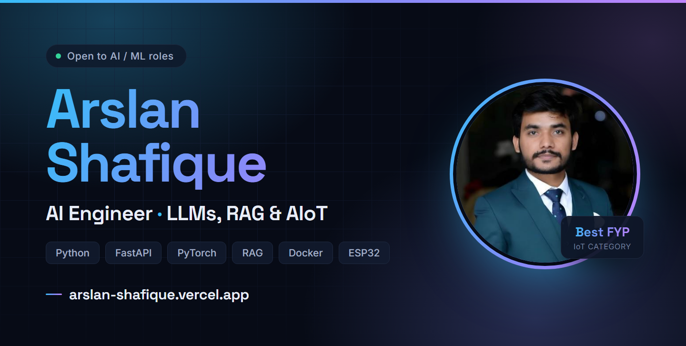

  

  
  
  
  

## 👋 About me

I am an **AI Engineer and Python developer** based in Lahore, Pakistan. I build practical systems across large language models, retrieval-augmented generation, machine learning, computer vision, backend APIs, and AI-powered IoT.

My favourite work sits where models meet real products: training and evaluating models, exposing them through FastAPI services, connecting databases and hardware, and shipping something people can actually use.

- 🎓 Computer Science graduate, University of Central Punjab — 2026
- 💼 Former AI Engineer Intern at Techohub Systems
- 🏆 Best Final Year Project winner in the IoT category
- 🌱 Growing through open-source contribution and code review
- 🎯 Open to AI and machine-learning opportunities

## 🚀 Featured builds

### [Smart Baby Band](https://github.com/arslan-shafique/Baby-Band-FYP)

An award-winning AIoT system that monitors infant health, motion, environment, and audio. I worked across ESP32 hardware integration, sensors, MQTT communication, the FastAPI backend, and the device-to-app data path.

`Python` `FastAPI` `ESP32` `MQTT` `Sensor Fusion` `AIoT`

### [Speech Emotion Recognition with XAI](https://github.com/arslan-shafique/speech-emotion-recognition-xai)

A deep-learning pipeline that recognizes emotion from speech while using explainable-AI techniques to make model predictions easier to interpret.

`Python` `PyTorch` `LSTM` `Audio Features` `XAI`

### [Smart Attendance System](https://github.com/arslan-shafique/smart-attendance-esp32cam)

An ESP32-CAM streams live video to a FastAPI and OpenCV recognition service, which verifies known students and records attendance automatically in Google Sheets.

`FastAPI` `OpenCV` `ESP32-CAM` `Face Recognition` `Google Apps Script`

  <a href="https://arslan-shafique.vercel.app/#projects"><strong>Explore all projects on my portfolio →</strong></a>

## 🌍 Open source

> **Currently contributing to [Oppia](https://github.com/oppia/oppia)** — an open-source educational platform making quality learning accessible worldwide.

My [Oppia pull request #27564](https://github.com/oppia/oppia/pull/27564) improves Python backend migration logic and adds focused tests that achieve **100% line and branch coverage** for `question_domain.py`.

My [Pylint pull request #11646](https://github.com/pylint-dev/pylint/pull/11646) adds the new `misplaced-module-dunder` convention check, together with functional tests, documentation, examples, and CI follow-up fixes.

  
  

## 🧰 Technology toolkit

  
  
  
  
  
  
  
  

- **AI and generative AI:** LLMs, RAG, NLP, deep learning, LSTM/RNN, computer vision, Hugging Face, LangChain, FAISS
- **Backend and data:** Python, FastAPI, REST APIs, JWT, PostgreSQL, MySQL, Pandas
- **IoT and hardware:** ESP32, ESP32-CAM, MQTT, Arduino, sensor integration
- **Product engineering:** Git, GitHub, Docker, testing, HTML, CSS, JavaScript

## 💼 Experience

**AI Engineer Intern · Techohub Systems · 2026** 
Built and extended LLM/RAG and ERPNext solutions using FastAPI, REST APIs, authentication, PostgreSQL, MySQL, Google APIs, Docker, and deployment configuration.

**Freelance Developer** 
Delivered machine-learning and responsive web projects, covering data preparation, model training, evaluation, and frontend implementation.

## 📬 Let’s connect

I am interested in AI engineering, machine-learning, Python backend, and AIoT opportunities.

- 🌐 [arslan-shafique.vercel.app](https://arslan-shafique.vercel.app)
- 💼 [linkedin.com/in/arslan-shafique](https://www.linkedin.com/in/arslan-shafique/)
- ✉️ [arslan.shafique253@gmail.com](mailto:arslan.shafique253@gmail.com)

<em>Build useful systems. Test them carefully. Keep learning in public.</em>

